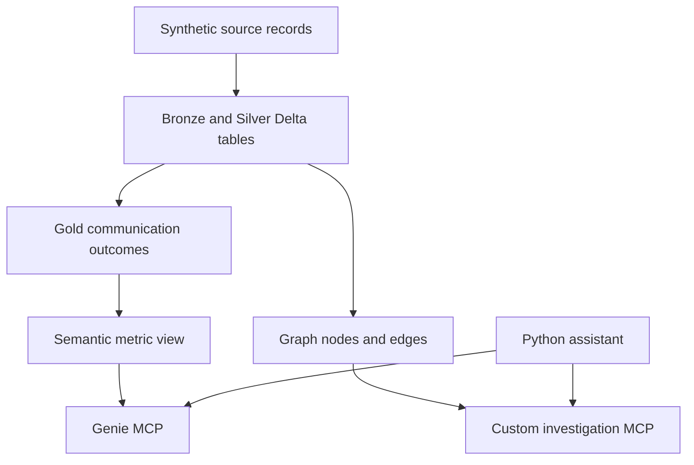

# Customer Journey Investigation on Databricks

A hands-on learning POC combining **Semantic Layer + Knowledge Graph + Genie + MCP**.
Designed to start small in **Databricks Free Edition**, using only fictional telecom data.

**Start here: [Step-by-step build guide](docs/BUILD_GUIDE.md).**

## Business problem

A customer activates a plan and should receive a welcome SMS within 15 minutes.
Business teams need consistent delivery metrics and evidence showing where communication failed.
This project builds governed measures and an operational graph, then connects analytics and
investigation tools through MCP to a conversational assistant.



## Run order

| Step | File / activity |
|---|---|
| 1 | Import [01_build_and_validate.ipynb](notebooks/01_build_and_validate.ipynb), choose catalog, Run All |
| 2 | Import [02_metric_view.ipynb](notebooks/02_metric_view.ipynb), choose same catalog, Run All |
| 3 | Create Genie experiences using [instructions](docs/GENIE_INSTRUCTIONS.md) and [benchmarks](docs/BENCHMARKS.md) |
| 4 | Follow guide to verify managed Genie MCP and deploy [graph MCP](mcp_server/) |
| 5 | Authenticate locally, configure URLs/model endpoint, run [agent/chat.py](agent/chat.py) |

Both notebooks are self-contained. No package installation is needed for the core data stage.
The optional assistant uses your Databricks model endpoint; it does not require an OpenAI API key.

## Included code

- `src/synthetic.py`: deterministic Python data generator; optional JSONL export.
- `sql/`: Gold transformations, graph traversal, evidence findings, semantic metric view and fallback.
- `notebooks/`: two importable Databricks notebooks with embedded code and assertions.
- `mcp_server/`: read-only, parameterized tools deployed on Databricks Apps.
- `agent/`: tool discovery / smoke test and a two-server conversational MCP client.
- `docs/`: detailed setup, exact expected results, troubleshooting and official references.
- `tests/`: source-derived outcome validation and optional DuckDB relational cross-check.
- `.github/workflows/checks.yml`: local-code checks on pushes and pull requests.

## Known expected results

10,000 mature communications: **9,500 on time, 200 late, 300 unconfirmed** → **5% SLA breaches**.
Also includes 20 pending, 20 ineligible, 100 recovered processing failures, duplicate callbacks,
exact raw duplicates, and a delivery exactly on the SLA boundary.

Unconfirmed findings: 180 validation failures, 90 provider rejections, 30 unknown.
All 200 late deliveries have unknown cause. Findings are conservative evidence associations.
The test truth table is not used by transformations, Genie, or MCP tools.

## Scope and validation status

Core data logic and SQL cross-checks can run locally. Databricks-specific metric views, Unity Catalog
permissions, Genie answers, hosted Apps, model calls and managed MCP availability require execution in
your workspace; this repository does not claim those live checks have already passed.

The full MCP stage is capability-gated. If your Free Edition workspace lacks managed Genie MCP,
you can finish the core Genie/graph demo, but must report the MCP integration as incomplete.

The first assistant is a CLI on your laptop, not a deployed chat UI. The custom graph App uses
its service principal identity and is intended only for your synthetic learning data. It does not
implement multi-user tenant isolation. The pipeline replaces a fixed snapshot and is not CDC.

## Local checks

```bash
python -m unittest discover -s tests -v
python -m compileall -q src agent mcp_server
python scripts/build_notebooks.py --check
```

Optional full relational cross-check:

```bash
pip install duckdb
python -m unittest discover -s tests -v
```

After editing generator/SQL sources, regenerate notebooks with `python scripts/build_notebooks.py`.
Free Edition is non-commercial and quota-limited. See [official references](docs/SOURCES.md).
